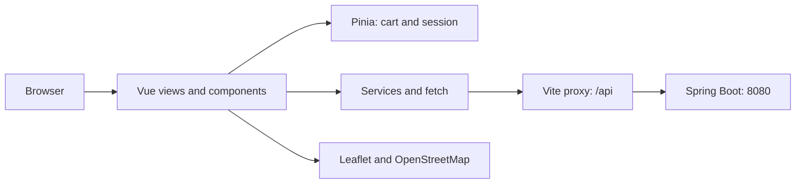

# Frontend Architecture

## Local Request Flow

In production, hosting must serve the SPA and route `/api` to the backend. The Vite development server is not assumed to be present.

## Organization

| Directory | Responsibility |
|---|---|
| `src/views` | Data loading and page composition |
| `src/components` | Forms, cards, map, and shared controls |
| `src/services` | Catalog, authentication, CSRF, and own orders |
| `src/stores` | Shared Pinia state |
| `src/router` | Public and private navigation |
| `src/scss` | Shared styles |

Reusable components include `AuthLayout`, `QuantityControl`, `ProductCard`, `FarmCard`, and `StateMessage`. `CheckoutPage` currently sends its order-creation request directly through `fetch`.

## State and Persistence

| Information | Storage |
|---|---|
| Cart | Pinia and `localStorage`, key `tierras-cart` |
| Authenticated profile | Pinia, restored through `/api/auth/me` |
| Session | Cookies and backend session; no JWT in `localStorage` |
| Latest confirmation | `sessionStorage`, key `tierras-last-order` |
| Users and orders | MySQL through the backend |

The cart does not synchronize across browsers or devices. `main.js` attempts to restore the session before initializing the router. Private routes check the store; the backend verifies authentication and order ownership.

## Catalog

`ProductsPage` fetches products and farms. Categories are derived from `product.category`, with `Todos` added. Search matches the product name and is combined with the selected category using AND.

Incorrect categories must be corrected in the data, not inferred from words in a name: `Faba del vino`, for example, should not be classified as wine.

## Authentication and CSRF

1. Fetch `/api/auth/csrf` with same-origin cookies.
2. Use the returned `headerName` and `token` in the POST.
3. Login returns the profile and establishes the session through cookies.
4. Registration performs a subsequent login and navigates to `/mi-cuenta`.
5. Logout is a CSRF-protected POST; the store is cleared after the server confirms it.

The service fetches a fresh CSRF token for each operation. It does not reuse a pre-login token or expose cookies or tokens in documentation examples.

## Images and Map

- `public/images/farms` contains local assets; `sources.json` records their sources.
- `image` is the farm card image and `bannerImage` is its detail-page banner.
- Products may use external images.
- Missing or failed images use a fallback asset.
- OpenStreetMap tiles require Internet access and retain their attribution.

## Deployment

The build produces `dist`. Public hosting must resolve SPA routes to `index.html`, route `/api`, use HTTPS, and maintain cookie settings compatible with the backend.
