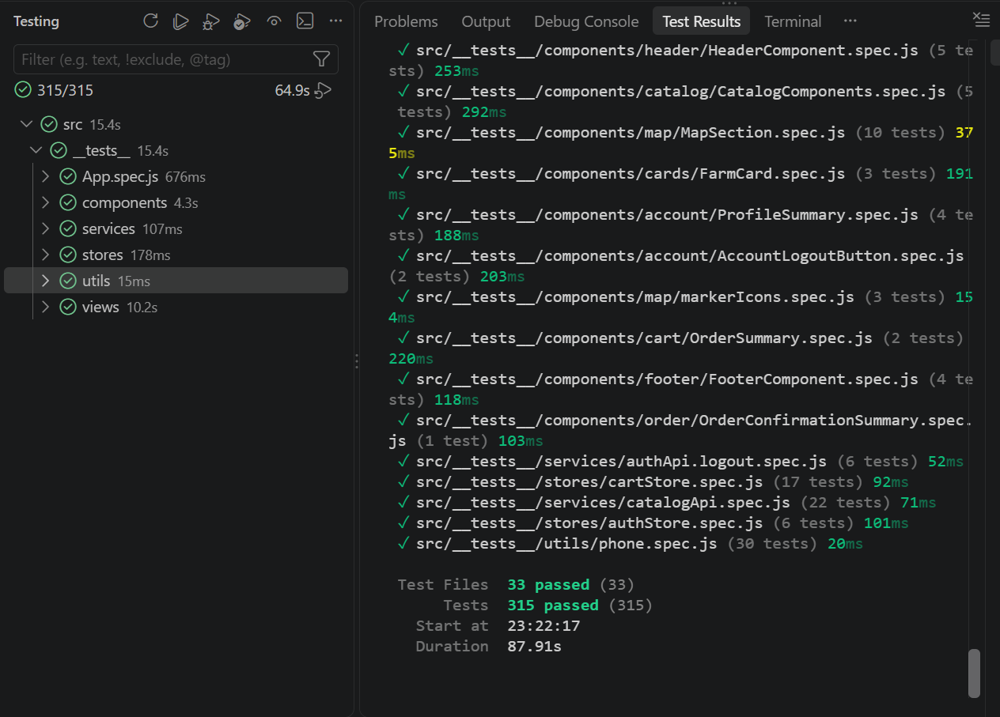
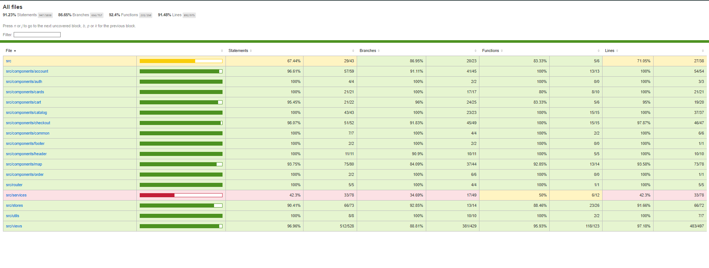
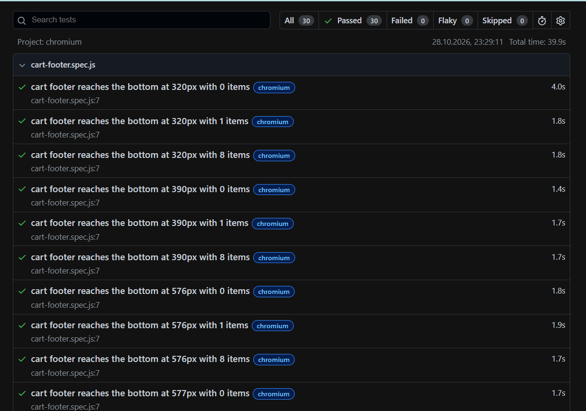

# Frontend Testing

## Unit Tests

Run from the repository root:

```bash
npm ci
npm run test:unit -- --run
```

Vitest uses jsdom and excludes `e2e`. Tests cover views, components, stores, and services: authentication, cart, checkout, confirmation, own orders, catalog, details, and map. Tests that mock services do not verify real MySQL persistence.

```bash
npm run test:unit -- --run src/__tests__/views/ProductsPage.spec.js src/__tests__/views/FarmDetailsView.spec.js
npm run test:coverage
```

Coverage is generated in `coverage/`. Do not claim a percentage without the date and scope of a verifiable run.

### Supplied Unit Test and Coverage Screenshots

The following screenshots were supplied on 2026-10-28. They document the runs shown, not a fresh execution performed while writing this page. Open an image to view it at full resolution.

The unit-test screenshot shows **315 passing tests in 33 files**.

[](../images/frontend-tests.png)

The coverage screenshot records these overall results:

| Metric | Coverage |
|---|---:|
| Statements | 91.23% |
| Branches | 86.65% |
| Functions | 92.40% |
| Lines | 91.48% |

[](../images/frontend-coverage.png)

**Coverage limitation:** this snapshot exceeds 90% line coverage but does not meet the configured 90% branch-coverage threshold. Passing unit tests alone does not mean the coverage check passes. Rerun the coverage command after changes and use its latest exit status and report for verification.

## Playwright

```bash
npx playwright install chromium
npm run test:e2e -- e2e/farm-navigation.spec.js --project=chromium
```

The configuration starts or reuses Vite on `5173`. In CI, it uses preview on `4173` and requires a prior build. The navigation test mocks catalog responses and does not create real orders.

Chromium, Firefox, and WebKit projects are configured. Running all of them requires installing their browsers.

### Supplied E2E Report

The supplied Playwright screenshot is dated **2026-10-28** and shows **30 passed, 0 failed, 0 flaky, and 0 skipped** checks in Chromium. The report header gives a total duration of 39.9 seconds.

[](../images/frontend-e2e-tests.png)

This run covers the five application-specific files: farm navigation, farm and product scroll restoration, sort-menu dismissal, and cart footer layout. It includes desktop and mobile-sized viewports; it is not a run on physical mobile devices. These tests use mocked API responses and do not establish that the live backend or database works.

Reproduce this scope and then open the HTML report:

```bash
npx playwright test --project=chromium --workers=2 --grep-invert "visits the app root url"
npx playwright show-report
```

The title filter excludes the outstanding starter test below. The HTML report is generated in `playwright-report/`; it is separate from Vitest's coverage report.

### Outstanding Starter Test

`e2e/vue.spec.js` expects `You did it!`, a heading that no longer matches the application. Update it before treating the complete suite as validated. This documentation does not modify or disable tests.

## Build

```bash
npm run build
```

A successful build does not prove that the backend, database, and external resources are available.

## Manual Checks

- Catalogs, categories, empty search results, details, and images.
- Map and navigation on desktop and mobile.
- Valid and invalid registration, duplicate email, and failed login.
- Remember-me login, logout, and private-route access.
- Empty cart, quantities, removal, and invalid delivery data.
- Guest and authenticated orders, history, pagination, and own order details.
- A different user must not access another customer's order.

Use a development database and fictitious data. A manual checkout creates real database records, unlike a unit test with a mocked API.
